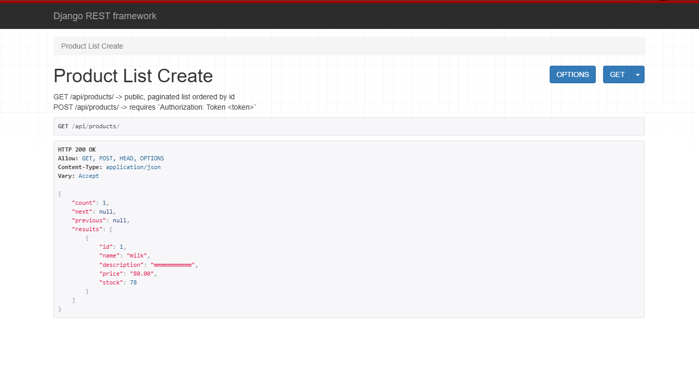

# Shop Product API

A small Django REST Framework API for an online shop, backed by **PostgreSQL**.
Anyone can view products; only authenticated users (Token auth) can add them.

- Project: `shop_project` | App: `products`
- `GET  /api/products/` — public, paginated (5 per page), ordered by `id`
- `POST /api/products/` — requires `Authorization: Token <token>`



## 1. Install dependencies

```bash
python -m venv venv
source venv/bin/activate        # Windows: venv\Scripts\activate
pip install -r requirements.txt
```

## 2. Create the PostgreSQL database

```bash
psql -U postgres
```
```sql
CREATE USER shop_user WITH PASSWORD 'shop_pass';
CREATE DATABASE shop_db OWNER shop_user;
```

Copy `.env.example` to `.env` and edit it if your credentials differ
(defaults already match the SQL above).

## 3. Run migrations

```bash
python manage.py migrate
```

## 4. Create a test user and token

```bash
python manage.py create_test_user
# optional: --username alice --password secret123
```
It prints the token. Use it as: `Authorization: Token YOUR_TOKEN`.
(Admin access, if wanted: `python manage.py createsuperuser`.)

## 5. Start the server

```bash
python manage.py runserver
```

## 6. Try it

```bash
# View products (no token)
curl http://127.0.0.1:8000/api/products/

# Add a product (token required)
curl -X POST http://127.0.0.1:8000/api/products/ \
  -H "Content-Type: application/json" \
  -H "Authorization: Token YOUR_TOKEN" \
  -d '{"name":"Notebook","description":"A notebook with 100 pages.","price":"120.00","stock":25}'

# Page two
curl "http://127.0.0.1:8000/api/products/?page=2"
```

In Postman: **Body → raw → JSON**, and add the `Authorization` header for POST.

## Validation rules

| Field | Rule |
|-------|------|
| name | not empty / not only spaces, max 100 chars |
| price | greater than zero, up to 2 decimal places |
| stock | whole number, not negative |
| id | auto-generated, read-only |

Errors return `400` with field messages, e.g. `{"price": ["Price must be greater than zero."]}`.
Missing/invalid token on POST returns `401`.

## Run automated tests

```bash
python manage.py test
```
(The DB user needs `CREATEDB` permission: `ALTER USER shop_user CREATEDB;`)

## Test checklist / screenshots to submit

1. GET without token → product list
2. POST valid + token → `201 Created`
3. POST without token → `401` (authentication error screenshot)
4. POST empty name → `400` (validation error screenshot)
5. POST price `0` / negative → `400`
6. POST negative stock → `400`
7. Add 6 products, then `GET /api/products/?page=2` → 6th product
